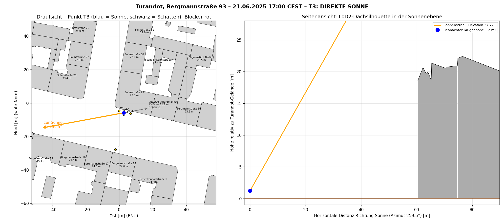
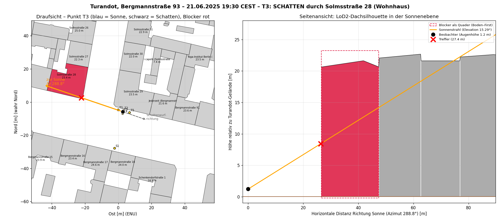
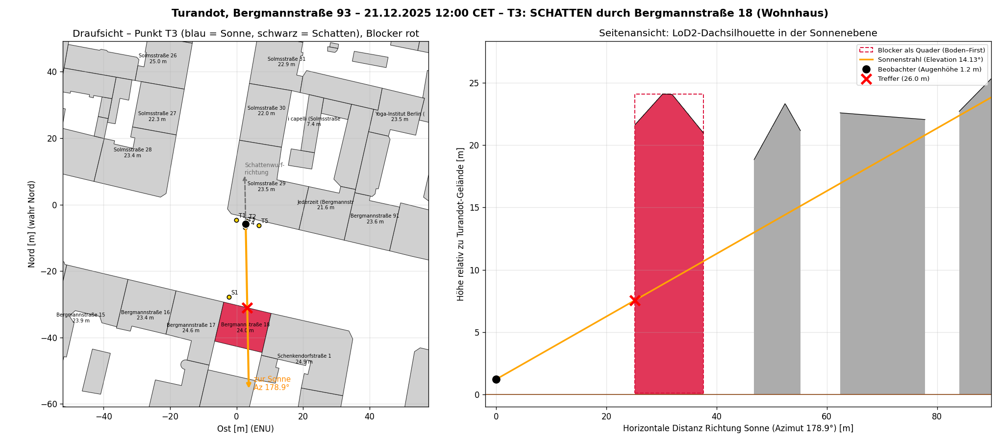

# Sonnenschein – ortsgenaue Sonnen- und Schattenberechnung (iOS)

> **„Wenn ich mich an diesem konkreten Ort zu diesem konkreten Zeitpunkt hinsetze, bekomme ich dort direkte Sonne ab?“**

Sonnenschein ist eine native iOS-App (SwiftUI, iOS 18+), die für einen **frei auf der Karte angetippten Punkt** in Berlin-Kreuzberg (PLZ 10961) berechnet, ob dort zu einem beliebigen Datum und einer beliebigen Uhrzeit **direkte Sonne** ankommt – oder welches **Gebäude** sie blockiert. Die Berechnung berücksichtigt die **tatsächliche 3D-Geometrie der umliegenden Gebäude** (amtliches Berliner LoD2), nicht nur den Sonnenstand.

Die Antwort liegt an **einem Tippen**: großer Status (☀️ Sonne / 🌑 Gebäudeschatten), der nächste Statuswechsel („Sonne bis 18:12“) und der komplette Tagesverlauf als Timeline.

---

## Inhalt

- [Status](#status)
- [Was die App kann](#was-die-app-kann)
- [Screenshots & Validierung](#screenshots--validierung)
- [Wie es funktioniert](#wie-es-funktioniert)
- [Architektur](#architektur)
- [Technologie-Stack](#technologie-stack)
- [Projektstruktur](#projektstruktur)
- [Setup & Build (Xcode)](#setup--build-xcode)
- [TestFlight-Deploy](#testflight-deploy)
- [Datenquellen & Lizenzen](#datenquellen--lizenzen)
- [Genauigkeit & Confidence](#genauigkeit--confidence)
- [Datenschutz](#datenschutz)
- [Bekannte Grenzen](#bekannte-grenzen)
- [Architekturentscheidungen (ADRs)](#architekturentscheidungen-adrs)
- [Roadmap](#roadmap)
- [Autor & Lizenz](#autor--lizenz)

---

## Status

| Phase | Beschreibung | Status |
|---|---|---|
| 0 | Recherche & Geodaten-Verifizierung | ✅ abgeschlossen |
| 1 | Sonnenstands-Engine (NREL SPA) | ✅ abgeschlossen |
| 2 | Geodaten-Pipeline (LoD2 → Geometry-Store) | ✅ abgeschlossen |
| 3 | Schatten-/Ray-Cast-Engine | ✅ abgeschlossen |
| 4 | Turandot Proof-of-Concept + Validierung | ✅ abgeschlossen |
| 5–8 | iOS-UX (SwiftUI + MapKit), Debug, A11y, QA | ✅ abgeschlossen |
| 9 | TestFlight-Build & Upload | 🔄 bereit, Upload durch Eigentümer |

33 Engine-Unit-Tests grün · Swift↔Python kreuzvalidiert (3080/3080) · PoC am Referenzort Turandot bestätigt.

---

## Was die App kann

- **Frei antippbare Karte** (MapKit): jeder Punkt in 10961 – Gehweg, Außengastronomie, Parkbank, Hof – nicht auf eine POI-Datenbank beschränkt. Die grundlegende Einheit ist eine **geografische Koordinate**.
- **Sofortergebnis**: direkte Sonne / Gebäudeschatten / Nacht, mit dem nächsten Statuswechsel.
- **Tagesverlauf** als kompakte, farbige Timeline (Gelb = Sonne, Grau = Schatten, Schwarz = Nacht) plus Sonnenfenster-Liste mit Gesamtdauer.
- **Zeit-Slider** (Sonnenaufgang–Sonnenuntergang) für interaktives Erkunden; **Datum-Selektor** (heute / morgen / beliebiges Datum).
- **Debug-Modus** (nur Debug-Builds): Azimut, Elevation, Bodenhöhe, geprüfte Gebäude, blockierendes Gebäude, Schnittdistanz, Rechenzeit, Datenquelle.
- **On-device**: keine Server-Abhängigkeit, kein Account, kein Login, kein Tracking. Standortfreigabe ist optional; die Karte ist auch ohne sie bedienbar.
- **Deutsch**, Dynamic Type, VoiceOver, ausreichende Kontraste; Status wird nie allein über Farbe kommuniziert (Symbol + Text).

---

## Screenshots & Validierung

Debug-Visualisierungen des Proof-of-Concept am Referenzort **Turandot, Bergmannstraße 93, 10961 Berlin** (Punkt T3, 2 m vor der Fassade):

| 21.06. 17:00 CEST – **Sonne** | 21.06. 19:30 CEST – **Schatten** | 21.12. 12:00 CET – **Schatten** |
|---|---|---|
|  |  |  |

Übersichtskarte der Gebäude im 500-m-Radius um Turandot: [`docs/turandot_building_map.png`](docs/turandot_building_map.png).

Der vollständige Validierungsbericht (Sonnenstunden je Jahreszeit, Plausibilitätsprüfungen, Regression, LoD2-vs-OSM-Vergleich) steht in **[`docs/turandot_validation.md`](docs/turandot_validation.md)**.

### Kernergebnis des PoC

| Prüfung | Ergebnis |
|---|---|
| 21.06.2025 17:00 CEST, Gehweg T1–T5 vor Turandot | **Sonne** (5/5), Az 259,48°, El 37,77° |
| Kontrollpunkt S1 (Südgehweg gegenüber), gleiche Zeit | Schatten durch Bergmannstraße 17 |
| Sonnenstunden T1–T5: 21.06. / 20.03.+22.09. / 21.12. | ≈ 9,8–10,2 h / ≈ 3,4–4,8 h / 0 h |
| Swift ↔ Python Kreuzvalidierung | 3080/3080 identisch (Sonnenwinkel 0° Diff., max. 0,5 mm Distanz) |
| Plausibilitätsprüfungen | 5/5 bestanden |
| Engine-Unit-Tests (Solar + Shadow) | 33 Tests grün |

> Hinweis zur Himmelsrichtung: Turandot liegt auf der **Nordseite** der Bergmannstraße; der Gehweg davor ist der nördliche und nach Süden (≈193°) exponiert – deshalb bekommt genau dieser Gehweg die Sonne. (Korrigiert die ursprüngliche Annahme „Südgehweg“; Details in `docs/turandot_validation.md`, Abschnitt 3.)

---

## Wie es funktioniert

Für jeden Beobachterpunkt P und Zeitpunkt:

1. **Sonnenposition** via **NREL SPA** (Reda & Andreas 2004): Azimut + Elevation, Genauigkeit ±0,0003°. Zeitzonen (CET/CEST, DST) über Foundation, nicht selbstgebaut.
2. Ist die Elevation ≤ 0° → **Nacht**.
3. Beobachter = Geländehöhe (DGM1) + **1,2 m** (sitzende Person, konfigurierbar).
4. **3D-Strahl** von P Richtung Sonne im lokalen **ENU-Koordinatensystem** (Nordachse = geografisch Nord).
5. **Spatial Index** (2D-Gitter, DDA-Traversierung) wählt die Gebäude, die den Punkt überhaupt treffen können – abhängig von Azimut, Elevation und Gebäudehöhe, nicht über einen willkürlich kleinen Radius.
6. **Ray–Triangle-Intersection** (Möller–Trumbore) gegen die triangulierten Gebäude. Treffer → **Gebäudeschatten** (inkl. Referenz auf das blockierende Gebäude), kein Treffer → **direkte Sonne**.

Der **Tagesverlauf** sampelt von Sonnenaufgang bis -untergang im 1-Minuten-Raster und verfeinert jeden Übergang per Bisektion auf ≈ 10 s.

Die Berechnung ist strikt **Layer 1 (geometrische Sonne)** – Wetter/Bewölkung (Layer 2) wird bewusst nicht vermischt.

---

## Architektur

- **SwiftUI + MVVM**, `@Observable`-State, iOS 18+.
- Die teure Rechenlogik liegt in einem `SolarComputationService` (**Actor**), läuft off-main-thread; UI reagiert über `async/await`. Schnelle Slider-Bewegungen brechen veraltete Berechnungen per **Task-Cancellation** ab.
- **On-device**-Architektur (siehe [ADR-003](docs/ADR-003-architecture.md)): der vorverarbeitete Geometry-Store für PLZ 10961 ist als Asset gebündelt und wird einmalig beim Start im Hintergrund geladen.
- Abstrahierte Provider (`GeodataProvider`, `SolarPositionProvider`, `ShadowEngine`) ermöglichen spätere Erweiterung (Kreuzberg → Berlin → Deutschland), ohne die App auf 10961 festzunageln.
- **Performance-Ziele**: Einzelpunkt < 200 ms, Tagesanalyse < 2 s. Ladeindikator erst ab 300 ms.

---

## Technologie-Stack

| Bereich | Technologie |
|---|---|
| Sprache | Swift 5.10 |
| UI | SwiftUI (iOS 18+) |
| Karte | MapKit |
| State | Observation (`@Observable`), MVVM |
| Nebenläufigkeit | Swift Concurrency (async/await, Actor) |
| Geometrie | lokales ENU-System, Möller–Trumbore, 2D-Gitterindex (DDA) |
| Sonnenalgorithmus | NREL SPA (Reda & Andreas 2004) |
| Geodatenformat | CityGML LoD2 → vorverarbeiteter Geometry-Store (JSON-Asset) |
| CRS | EPSG:25833 (ETRS89/UTM 33N) → WGS84 → lokal ENU |
| Höhenbezug | DHHN2016 / DGM1 |
| Projektgenerierung | XcodeGen (aus `project.yml`) |
| Tests | XCTest (Engine, Linux-validiert) |

---

## Projektstruktur

```
swift_space/
  project.yml                         XcodeGen-Spezifikation (die .xcodeproj wird hieraus erzeugt)
  Config.xcconfig                     Build-Konfiguration (API_BASE_URL bewusst leer – kein Backend)
  Assets.xcassets/
    AppIcon.appiconset/               App-Icon (Sonne)
    TurandotBuildings.dataset/        gebündelter Geometry-Store (LoD2, ENU)
  Resources/turandot_buildings.json   Geometrie als Ressource
  Sources/
    App/                              @main, RootView, AppModel-Verdrahtung, Config
    Models/                           AppModel, SolarComputationService (Actor), Result-Modelle, LocationProvider
    Views/                            MapScreen, SolarResultSheet, DayTimelineView, TimeSliderView,
                                      DateSelectorView, SunWindowsList, DebugPanelView, ContentView
      DesignSystem/                   Theme (Farben/Fonts/Spacing), StatusBadge, InfoCard, Formatters (de_DE)
    Engine/
      SolarEngine/                    NREL SPA (SolarPositionCalculator.swift, SPATables.swift)
      ShadowEngine/                   Ray-Casting (ShadowEngine, Geometry [Möller–Trumbore], GeometryStore,
                                      SpatialGridIndex [2D-Gitter, DDA])
docs/                                 ADRs, Validierungsbericht, Debug-Visualisierungen
SETUP_XCODE.md                        Lokaler Build & Deploy über Xcode
PUSH_TO_GITHUB.md                     Dieses Projekt nach GitHub schieben
ux_design.md                          Vollständige UX-/UI-Spezifikation der App
```

> Das Berechnungs-Backend (Python-Pipeline, Golden-Test-Dataset, Kreuzvalidierung Swift↔Python) liegt im Schwester-Projekt `sonnenschein/` (Phase 0–4). Dieses Repo enthält die **iOS-App** mit integrierter Engine.

---

## Setup & Build (Xcode)

Es gibt **bewusst keine** eingecheckte `.xcodeproj` – sie wird aus `swift_space/project.yml` mit **XcodeGen** erzeugt:

```bash
brew install xcodegen          # einmalig
cd swift_space
xcodegen generate              # erzeugt SonnenscheinIos.xcodeproj
open SonnenscheinIos.xcodeproj
```

Voraussetzungen: aktuelles Xcode, Apple ID in *Xcode → Settings → Accounts* (Team `8ZKX2W54FA`).

Ausführliche Anleitung inkl. Signing/Bundle-ID: **[`SETUP_XCODE.md`](SETUP_XCODE.md)**.

---

## TestFlight-Deploy

1. `xcodegen generate` ausführen, Projekt in Xcode öffnen.
2. **Signing & Capabilities**: eigenes Team wählen und eine **eigene Bundle-ID** setzen (die im Repo hinterlegte `com.abacusai.…` gehört zur Build-Plattform und funktioniert in deinem Account nicht; z. B. `de.kaldenbach.sonnenschein`).
3. Ziel **„Any iOS Device (arm64)“** → **Product → Archive**.
4. Im Organizer: **Distribute App → App Store Connect → Upload**.
5. Nach der Verarbeitung erscheint der Build in App Store Connect unter **TestFlight**.

Details in [`SETUP_XCODE.md`](SETUP_XCODE.md).

---

## Datenquellen & Lizenzen

| Daten | Quelle | Lizenz |
|---|---|---|
| LoD2-Gebäudemodell + DGM1-Geländemodell Berlin | Senatsverwaltung für Stadtentwicklung, Bauen und Wohnen Berlin / Geoportal Berlin | **Datenlizenz Deutschland – Zero – 2.0** |
| Turandot-Koordinate, OSM-Fallback-Ausschnitt, Adressbeschriftungen | OpenStreetMap | © OpenStreetMap-Mitwirkende, **ODbL 1.0** |

Vollständige Nachweise und die CRS-Kette: [`docs/ADR-001-geodata-sources.md`](docs/ADR-001-geodata-sources.md) und [`DATA_LICENSES.md`](DATA_LICENSES.md).

**Code-Lizenz:** MIT – siehe [`LICENSE`](LICENSE).

---

## Genauigkeit & Confidence

- **Sonnenposition**: NREL SPA, ±0,0003° (siehe [ADR-002](docs/ADR-002-solar-algorithm.md); der einfachere Meeus-Algorithmus würde Schattenkanten um bis zu 0,47 m verschieben – deshalb SPA).
- **Datengenauigkeit** ist der begrenzende Faktor, nicht die Mathematik: LoD2-Höhen ≈±0,5–1 m, Dachformen generalisiert. Ergebnisse werden deshalb nicht scheingenauer dargestellt, als die Eingangsdaten hergeben. Vollständiges Fehlerbudget: [`docs/ACCURACY.md`](docs/ACCURACY.md).
- **Confidence** `high` bei vollständigem LoD2 und eindeutiger Lage; niedriger bei Datenlücken, Grenzlagen oder OSM-Fallback (Kriterien in ADR-001).
- Dedizierte numerische **Toleranzen** (Epsilon-Werte) verhindern flackernde Ergebnisse an Gebäudekanten (Tabelle im Engine-README / `Geometry.swift`).

---

## Datenschutz

- **Kein Account, kein Login, keine Registrierung.**
- Standortfreigabe ist **optional** – die Karte funktioniert vollständig ohne sie.
- **Keine Standortdaten verlassen das Gerät** (kein Backend, `API_BASE_URL` leer).
- Kein Tracking, keine Analytics, keine Werbung.

Siehe auch [`DATA_LICENSES.md`](DATA_LICENSES.md).

---

## Bekannte Grenzen

- **Nicht modelliert**: Bäume (die Bergmannstraße hat Straßenbäume), Markisen, Sonnenschirme, Dachüberstände/Gauben, Gelände als Verdecker. Reale Sonnenzeiten können daher kürzer sein.
- **Gebiet**: nur PLZ 10961. Punkte außerhalb liefern eine klare Hinweismeldung.
- **Wetter** ist nicht enthalten (geometrische Sonne, Layer 1).
- Die Engine wurde in Phase 0–4 unter Linux gegen eine unabhängige Python-Referenz validiert; die App läuft auf iOS 18+.

---

## Architekturentscheidungen (ADRs)

| ADR | Inhalt |
|---|---|
| [ADR-001](docs/ADR-001-geodata-sources.md) | Geodatenquellen: Berliner LoD2 (CityGML, ATOM-Bulk, dl-de/zero-2-0), DGM1, WFS-Befund, OSM-Fallback, CRS-Kette, Confidence-Kriterien, Testpunkte |
| [ADR-002](docs/ADR-002-solar-algorithm.md) | NREL SPA statt vereinfachtem Meeus (gemessen: bis 0,47 m Schattenkantenversatz) |
| [ADR-003](docs/ADR-003-architecture.md) | On-device mit gebündeltem Geometry-Store für 10961 + WFS-Fallback; Hybrid als Ausbaustufe |

---

## Roadmap

Die Architektur ist auf diese Erweiterungen vorbereitet (noch nicht umgesetzt):

- **A.** Ganz Berlin (weitere Tiles) → **B.** Deutschland (alternative LoD2-Provider)
- **C.** Venue-Datenbank („Wo kann ich jetzt in Kreuzberg in der Sonne sitzen?“)
- **D.** Wetter (Cloud Cover als separater Layer) → **E.** Bäume/Vegetation
- **F.** Favoriten · **G.** Benachrichtigungen („In 20 Min. kommt bei Turandot die Sonne raus“) · **H.** AR-Sonnenbahn · **I.** Zukunftssuche

---

## Autor & Lizenz

**Mark-Alexander Kaldenbach** · GitHub: [@Budonist](https://github.com/Budonist)

Persönliches Projekt. Lizenz: **MIT** (siehe [`LICENSE`](LICENSE)).
Geodaten-Nachweise: [`DATA_LICENSES.md`](DATA_LICENSES.md).

---

_Entwickelt als native iOS-App; Rechen-Engine validiert in Phase 0–4 (siehe `docs/`)._
