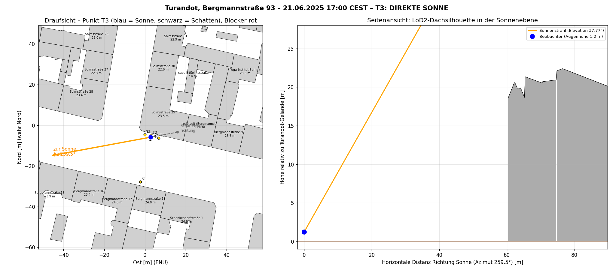
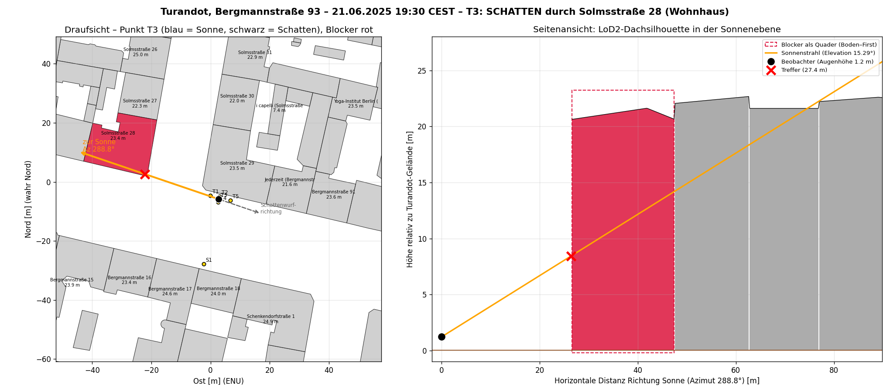
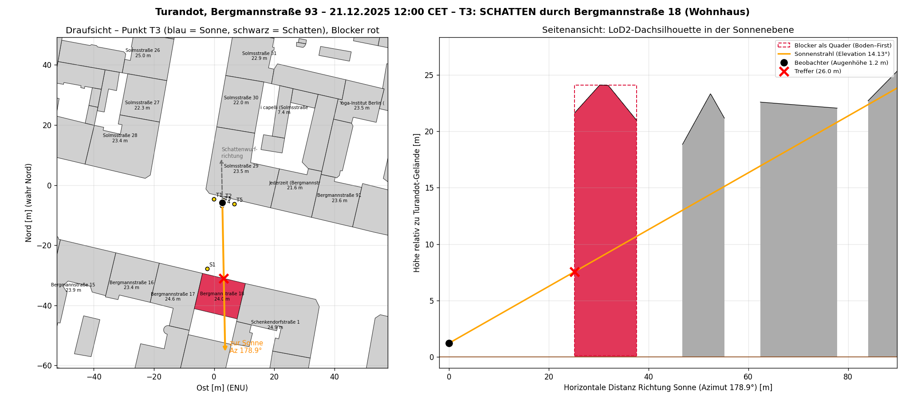

# Turandot – Validierung des Proof-of-Concept (Phase 4)

_Automatisch erzeugt von `scripts/turandot_poc.py` – nicht manuell bearbeiten; Interpretation in Abschnitt 6._

**Ort:** Turandot, Bergmannstraße 93, 10961 Berlin (OSM-Node 2245836213, 52.4894903 N / 13.3922155 E)  
**Datenbasis:** amtliches Berliner LoD2 (CityGML, 1 330 Gebäude im 500-m-Radius, 67 331 Dreiecke) + DGM1  
**Engine:** Swift `ShadowEngine` (Ray-Casting, Möller–Trumbore) + NREL SPA; gegengeprüft mit unabhängiger Python-Referenz (pvlib-SPA, R-Tree, shapely)  
**Augenhöhe:** 1.2 m über DGM-Gelände

## 1. Kernfrage: 21.06.2025, 17:00 CEST

| Punkt | Swift | Python | Azimut | Elevation | Blocker |
|---|---|---|---|---|---|
| T1 | **sun** | sun | 259.482° | 37.770° | – |
| T2 | **sun** | sun | 259.482° | 37.770° | – |
| T3 | **sun** | sun | 259.482° | 37.770° | – |
| T4 | **sun** | sun | 259.482° | 37.770° | – |
| T5 | **sun** | sun | 259.482° | 37.770° | – |
| S1 | **shadow** | shadow | 259.483° | 37.770° | Bergmannstraße 17 (Wohnhaus) |

**Antwort:** Ja. Alle fünf Gehweg-Testpunkte vor Turandot haben direkte Sonne. Die Sonne steht im WSW (≈259°) knapp 38° hoch; in dieser Richtung verläuft die Bergmannstraße bzw. die Kreuzung Solmsstraße, sodass der Strahl über die Straßenschlucht hinweg frei ist.

## 2. Sonnenstunden je Stichtag (1-min-Auflösung)

| Tag | Punkt | Tageslicht | Direkte Sonne | Sonnenfenster | häufigster Blocker |
|---|---|---|---|---|---|
| Frühlings-Tagundnachtgleiche | T1 | 12.1 h | 4.5 h | 07:15–11:47 | Bergmannstraße 17 (Wohnhaus) |
| Frühlings-Tagundnachtgleiche | T2 | 12.1 h | 4.8 h | 07:17–12:02 | Bergmannstraße 17 (Wohnhaus) |
| Frühlings-Tagundnachtgleiche | T3 | 12.1 h | 3.8 h | 07:14–10:58, 11:30–11:32 | Bergmannstraße 17 (Wohnhaus) |
| Frühlings-Tagundnachtgleiche | T4 | 12.1 h | 3.4 h | 07:11–10:32 | Bergmannstraße 17 (Wohnhaus) |
| Frühlings-Tagundnachtgleiche | T5 | 12.1 h | 3.9 h | 07:15–11:11 | Bergmannstraße 18 (Wohnhaus) |
| Frühlings-Tagundnachtgleiche | S1 | 12.1 h | 0.8 h | 06:34–07:25 | Bergmannstraße 18 (Wohnhaus) |
| Sommersonnenwende | T1 | 16.8 h | 9.9 h | 09:14–19:08 | Solmsstraße 29 (Wohnhaus) |
| Sommersonnenwende | T2 | 16.8 h | 9.8 h | 09:19–19:06 | Solmsstraße 29 (Wohnhaus) |
| Sommersonnenwende | T3 | 16.8 h | 10.0 h | 09:10–19:11 | Solmsstraße 29 (Wohnhaus) |
| Sommersonnenwende | T4 | 16.8 h | 10.2 h | 09:01–19:15 | Solmsstraße 29 (Wohnhaus) |
| Sommersonnenwende | T5 | 16.8 h | 9.9 h | 09:15–19:09 | Solmsstraße 29 (Wohnhaus) |
| Sommersonnenwende | S1 | 16.8 h | 3.9 h | 07:19–09:48, 18:49–20:12 | Bergmannstraße 18 (Wohnhaus) |
| Herbst-Tagundnachtgleiche | T1 | 12.1 h | 4.5 h | 08:02–12:34 | Bergmannstraße 17 (Wohnhaus) |
| Herbst-Tagundnachtgleiche | T2 | 12.1 h | 4.8 h | 08:03–12:50 | Bergmannstraße 17 (Wohnhaus) |
| Herbst-Tagundnachtgleiche | T3 | 12.1 h | 3.9 h | 08:00–11:47, 12:14–12:20 | Bergmannstraße 17 (Wohnhaus) |
| Herbst-Tagundnachtgleiche | T4 | 12.1 h | 3.4 h | 07:57–11:21 | Bergmannstraße 17 (Wohnhaus) |
| Herbst-Tagundnachtgleiche | T5 | 12.1 h | 4.0 h | 08:01–12:00 | Bergmannstraße 18 (Wohnhaus) |
| Herbst-Tagundnachtgleiche | S1 | 12.1 h | 0.9 h | 07:19–08:11 | Bergmannstraße 18 (Wohnhaus) |
| Wintersonnenwende | T1 | 7.6 h | 0.0 h | – | Bergmannstraße 17 (Wohnhaus) |
| Wintersonnenwende | T2 | 7.6 h | 0.0 h | – | Bergmannstraße 17 (Wohnhaus) |
| Wintersonnenwende | T3 | 7.6 h | 0.0 h | – | Bergmannstraße 17 (Wohnhaus) |
| Wintersonnenwende | T4 | 7.6 h | 0.0 h | – | Bergmannstraße 17 (Wohnhaus) |
| Wintersonnenwende | T5 | 7.6 h | 0.0 h | – | Schenkendorfstraße 1 (Wohnhaus) |
| Wintersonnenwende | S1 | 7.6 h | 0.0 h | – | Bergmannstraße 18 (Wohnhaus) |

## 3. Plausibilitätsprüfungen

| Prüfung | Ergebnis | Befund |
|---|---|---|
| Straßenrichtung Bergmannstraße ≈ West–Ost (Fassadenazimut 100°±15° bzw. 280°±15°) | ✔ bestanden | Fassade verläuft mit 103.1° / 283.1° |
| Turandot-Gebäude liegt nördlich der Testpunkte (Nordseite der Straße) | ✔ bestanden | Gebäudeschwerpunkt +11.1 m nördlich der Testpunkte; Fassade zeigt nach 193.1° (SSW) |
| Sommer-Nachmittag (21.06., 16:00 und 17:00 CEST): Gehweg vor Turandot in der Sonne | ✔ bestanden | alle T1–T5 'sun' |
| Winter (21.12.): deutlich weniger Sonnenstunden als im Sommer (< 25 %) | ✔ bestanden | Ø 0.00 h (Dez) vs. 9.97 h (Jun) |
| Gegenüberliegender Südgehweg S1 (Nordfassade dahinter) hat mittags im Winter keine Sonne | ✔ bestanden | S1 21.12. 12:00: shadow |

Vergleichspunkt **S1** (52.48924087, 13.39218058): gegenüberliegender Gehweg, 2 m vor der Nordfassade der Südseite; Straßenbreite Fassade–Fassade ≈ 26.5 m.

**Hinweis zur Aufgabenformulierung:** Die Annahme „Sonne fällt nachmittags auf den Südgehweg“ trifft auf Turandot nicht zu: Turandot liegt auf der *Nordseite* der Straße, der Gehweg davor ist der *nördliche* Gehweg vor einer nach SSW (≈193°) orientierten Fassade. Genau dieser Gehweg ist südexponiert und bekommt Sonne; der südliche Gehweg (S1) liegt im Schatten der eigenen Häuserzeile, solange die Sonne südlich steht.

## 4. Regression & Robustheit

- 294 Fälle (Testpunkte T1–T5 + S1, 4 Stichtage, volle Stunden 05–21 Uhr, nur Tageslicht): 94 Sonne, 200 Schatten.
- Python-Referenz stimmt in 294/294 Fällen exakt überein (Status + Gebäude-ID).
- Robust gegenüber Sonnenstand ±0.05° und Augenhöhe 1.0/1.6 m: 288/294. Nicht robuste Fälle (Strahl streift eine Dach-/Fassadenkante) sind in der Fixture mit `"robust": false` markiert und werden in den Swift-Regressionstests nur protokolliert, nicht hart geprüft.

Nicht robuste Fälle:

| Punkt | Datum | Zeit | Ergebnis | Blocker |
|---|---|---|---|---|
| T3 | 2025-03-20 | 11:00 | shadow | Schenkendorfstraße 1 (Wohnhaus) |
| T1 | 2025-03-20 | 12:00 | shadow | Bergmannstraße 18 (Wohnhaus) |
| T2 | 2025-03-20 | 12:00 | sun | – |
| T5 | 2025-03-20 | 12:00 | shadow | Bergmannstraße 18 (Wohnhaus) |
| T5 | 2025-09-22 | 12:00 | shadow | Schenkendorfstraße 1 (Wohnhaus) |
| T2 | 2025-09-22 | 13:00 | shadow | Bergmannstraße 18 (Wohnhaus) |

## 5. LoD2 vs. OSM-Fallback

Dieselben 294 Abfragen gegen den OSM-Fallback-Store (Flachdach-Extrusion, Höhe = `building:levels` × 3 m + 1 m, flaches Gelände, OSM-API-Ausschnitt ≈ 370 × 220 m):

- übereinstimmend: 250/294 (85.0 %)
- lod2_shadow_osm_sun: 44

Abweichungen entstehen vor allem durch fehlende Dachformen (Satteldächer/Mansarden), geschätzte Geschosshöhen und die räumlich begrenzte OSM-Abdeckung. LoD2 bleibt die verbindliche Datenbasis (Confidence `high`); OSM nur als gekennzeichneter Fallback (`low`/`very_low`), siehe ADR-001.

## 6. Interpretation & bekannte Grenzen

- Die Engine bestimmt ausschließlich **Gebäudeverschattung**. Bäume (die Bergmannstraße hat Straßenbäume), Markisen, Sonnenschirme und Fahrzeuge sind nicht modelliert – reale Sonnenzeiten können daher kürzer sein.
- LoD2-Dächer sind generalisiert (Dachaufbauten, Gauben, Schornsteine fehlen); Traufkanten-Lagefehler ≈ ±0.5 m führen bei Elevationen < 10° zu Zeitunsicherheiten von einigen Minuten.
- Refraktionskorrigierte (scheinbare) Elevation wird verwendet; nahe dem Horizont (< 1°) ist die Refraktion wetterabhängig (±0.2°).
- Gebäude außerhalb 500 m werden ignoriert – relevant erst für Elevationen < ~3° (Höhe 25 m / 500 m).

## 7. Debug-Visualisierungen (Punkt T3, 2 m vor der Fassade)

- `turandot_debug_1_sommer_1700.png` – 21.06.2025 17:00 CEST: **sun**
  
- `turandot_debug_2_sommer_1930.png` – 21.06.2025 19:30 CEST: **shadow** (Blocker: Solmsstraße 28 (Wohnhaus))
  
- `turandot_debug_3_winter_1200.png` – 21.12.2025 12:00 CET: **shadow** (Blocker: Bergmannstraße 18 (Wohnhaus))
  
